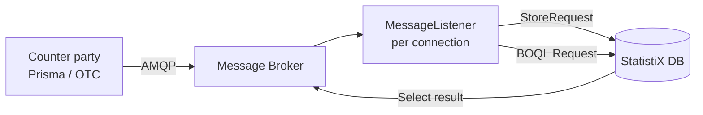

# SRI Technical Components

## Prisma (core startup)
1. Program start point (`main`) is in the **Prisma library**.
2. Configuration file is loaded.
3. Initialization of the common engine part (**sri.jar**) is called.
4. Database is queried for the list of **broker queues (connection strings)** this engine must connect to.
5. For each AMQP connection a **MessageListener** is defined, started when a new message is available.
6. Each incoming message is handled in a **separate thread**.

## Message types
| Type | Action | Example DB object |
|------|--------|-------------------|
| StoreRequest | Stores data (insert, update) | `SRI_ACC.D_SRI_PRISMA_STORE_REQUEST@DWHDTBPRISPRIMA.WORLD` |
| BOQL Request | Selects data, sends answer back to AMQP broker | `SRI_ACC.D_SRI_REQUEST@DWHDTBPRISPRIMA.WORLD` |

## Flow

## Log analysis hints
- Startup failures: check config file load, sri.jar init, DB query for queue list.
- Connection failures: check AMQP connection strings from DB.
- StoreRequest failures: check insert/update errors, metadata/protofile mismatch.
- BOQL failures: check select errors and reply send to AMQP.

## Processing paths (DOU summary)

### GPB / StoreRequest path
The DOU describes the high-level path as:
1. AMQP consumer receives the binary payload.
2. StoreRequest processing deserializes the Protobuf request.
3. An entity/field tag is resolved to a business object through a registry.
4. Business-object action metadata selects generated mapper and SQL definitions.
5. Mappers bind payload fields to JDBC prepared statements and batch execution writes to Oracle.
6. Successful work commits; exceptions trigger rollback. Optional HDFS/Avro storage and resource-status indicator handling may also occur when configured.

The DOU names components such as `StoreRequestProcess`, `EntityRegistry`, `GPBParser`, and generated insert/select mappers. Treat class names and exact call ordering as version-dependent implementation details; confirm against the deployed code before using them as a root-cause fact. The DOU's acknowledgement ordering is not a substitute for verifying the actual broker acknowledgement behavior.

### BOQL / SRI request path
The DOU describes BOQL/XML requests being schema-validated, parsed into transaction/select operations, resolved against business-object metadata, transformed into SQL, executed on Oracle, mapped to XML or GPB, and returned to the client. It also identifies embedded and streamed response modes. Invalid XML may be rejected as `BAD_REQUEST`; other documented error examples include `QUERY_TIMEOUT` and `SERVER_ERROR`.

### Observed ACC BOQL trace
Source: user-provided `PRISMA_ACC.log` excerpt dated 2026-10-06, received 2026-10-07. Identifiers and connection details are omitted here; this is one observed trace, not a universal protocol contract.

1. `received message is type of ByteMessage` identifies the incoming message as `BOQL`.
2. `case: SELECT request ID` supplies the request UUID and transaction UUID for correlation; `get transaction` follows.
3. `getBusinessObject` identifies `ResourceStatus`, instance `[8]`, source `205`, and output format `google-protocol-buffers`. A matching business-object lookup is logged.
4. JDBC connection/pool diagnostics follow. Pooling is enabled in the logged settings, with one active and nine idle connections; these counts are a point-in-time observation, not a capacity baseline.
5. A missing `STATUS` result-column diagnostic is explicitly logged as ignorable. The thread continues with `targetTransferType: STREAMED`.
6. Reply logging reports a BOQL chunk at index 0, a response count of one record / 16 bytes, then a GPB chunk at index 1. Both reply lines report `sendRetryCount: 0`; the final prepare line has a trailing `true` flag whose meaning is not established by this excerpt.
7. Thread-count cleanup is logged afterward. This does not establish that the transaction was closed or the client received the result.

`google-protocol-buffers` in a business-object/output-format line or `jmsType:GPB` in a reply is not evidence of an incoming GPB StoreRequest. Distinguish incoming message type and operation from outgoing result format.

Thread labels help locate related lines, but correlate request/transaction IDs and timestamps as well; a thread can handle more than one operation. Line-by-line thread filtering may omit multiline XML request/response bodies that do not repeat the thread label. This supplied excerpt contains no complete XML body, generated SQL, or separate StoreRequest trace. The reply text `Replied Message: NULL!` alone does not prove an empty response: the same sequence reports nonzero body lengths and a record count.

## Framework and model layers
- **SRI framework (`sri.jar` / STX.SRI_SRI):** generic engine, metadata loading, transaction management, JDBC access, request processing, logging, and result mapping.
- **PRISMA model layer:** model-specific business objects, generated mappers, SQL/metadata registrations, and deployment assets, loaded with the common SRI framework.
- The DOU describes behavior as metadata-driven: model/object state, business-object attributes/actions, mapper classes, SQL definitions, and queue assignments determine runtime behavior.

## Data storage patterns
The DOU gives these common naming patterns:
- `D_STA_*`: reference/dimension-style data.
- `F_FCT_*`: fact/historical data.
- `S_STG_*`: staging data, including Snap/Live processing.
- `D_SRI_*` and `F_SRI_*`: metadata/catalog and state/configuration objects.

It describes historized records with columns such as `VALID_FROM_PT`, `VALID_TO_PT`, `FACT_TIMESTAMP`, `ITS`, and `UTS`. It also describes update processing as preserving history through versioned records. Validate per-entity semantics against the generated SQL and current model; these patterns are not universal guarantees.
